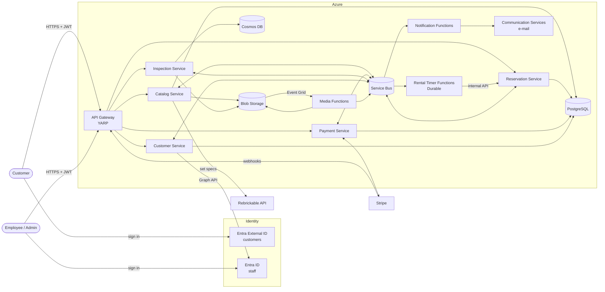
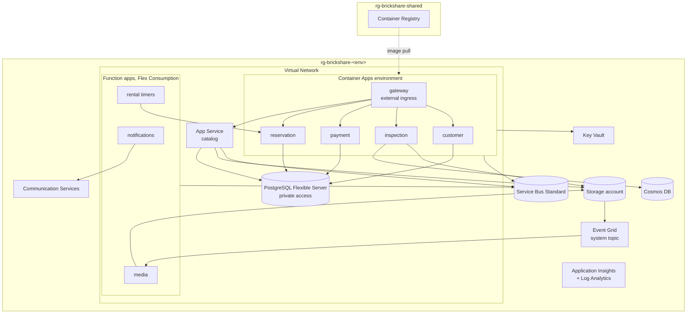
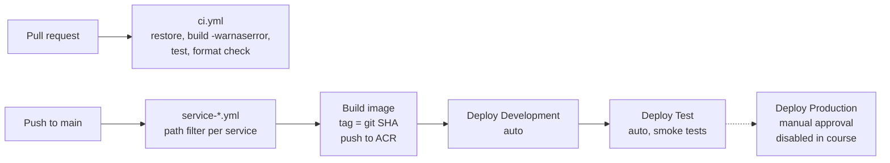

# BrickShare Architecture

BrickShare is an online shop for renting Lego sets. This document describes the technical architecture. It is based on [Course idea.md](Course%20idea.md).

| Document | Content |
|----------|---------|
| [docs/features](features/README.md) | Features: business rules, endpoints, events, flows |
| [docs/CoursePlan.md](CoursePlan.md) | Course modules and lessons |
| [docs/Progress.md](Progress.md) | Implementation progress |

## 1. Overview

### 1.1 Goal

Teach developers how to build, run, and deploy a .NET 10 microservice application on Azure. The application must be realistic enough to cover identity, payments, multiple data stores, async messaging, two hosting options, and a multi-environment CI/CD pipeline.

### 1.2 Actors

| Actor | Identity provider | Main capabilities |
|-------|-------------------|-------------------|
| Customer | Microsoft Entra External ID (e-mail OTP, Google, Facebook) | Browse catalog, reserve and pay, see reservation history |
| Employee | Microsoft Entra ID (workforce tenant), app role `Employee` | Hand over sets, inspect returned sets, record damage, charge extra fees |
| Admin | Microsoft Entra ID (workforce tenant), app role `Admin` | Manage catalog and instances, register staff and assign roles, ban customers. Admin can also do all Employee tasks |

### 1.3 Scope and assumptions

- **Minimal APIs.** All HTTP APIs (services, gateway endpoints, internal endpoints) use ASP.NET Core Minimal APIs, not MVC controllers. Endpoints are grouped per feature with `MapGroup` and endpoint filters.
- **Backend only.** The course focuses on APIs. Each API exposes OpenAPI documents and a Scalar UI for testing. A customer portal and a staff portal (SPA) can be added later. They do not change the backend design.
- **Azure Service Bus** is the message broker for async communication between services. The course idea does not name a broker, but a microservice architecture needs one.
- **Microsoft Entra External ID** is used for customers. Azure AD B2C is not available for new tenants, and External ID supports e-mail one-time passcode and social logins.
- **Supporting Azure services:** Key Vault, Azure Container Registry, Application Insights with Log Analytics, Managed Identity, Azure Communication Services (e-mail), Event Grid.
- **Azure Functions** host the event-driven and timer-driven parts: notifications, image processing, and rental timers ([Serverless functions](#37-serverless-functions)).
- **Infrastructure as code** uses Terraform.
- **Production is designed but not provisioned.** It costs too much for a course. Development and Test run in Azure. Production uses the same mechanism with more powerful and more expensive resources (see [Azure deployment topology](#9-azure-deployment-topology)).
- **Money** is stored in minor units (`long` cents) with an ISO currency code. One currency (EUR) is used in the course.
- **Time** is stored in UTC (`timestamptz` / `DateTimeOffset`). Rentals are counted in whole days.

## 2. System context



## 3. Services

Each service owns one bounded context and its own data. Services talk synchronously only through the gateway (client calls) or through a small number of internal HTTP calls listed below. All other communication between services uses integration events on Service Bus.

### 3.1 API Gateway

| Item | Value |
|------|-------|
| Technology | ASP.NET Core + YARP reverse proxy |
| Hosting | Azure Container Apps, external ingress |
| Data | None |

Responsibilities:

- Single public entry point: `https://api.brickshare.<env>/...`.
- Routes by path prefix: `/catalog`, `/reservations`, `/payments`, `/inspections`, `/customers`, `/staff`.
- Validates JWTs from both issuers before forwarding. Services validate the token again (defense in depth).
- Rate limiting (`Microsoft.AspNetCore.RateLimiting`), CORS, request size limits.
- Forwards `/payments/webhooks/stripe` without JWT validation. The Payment Service verifies the Stripe signature.
- Adds and forwards `traceparent` headers for distributed tracing.

### 3.2 Catalog Service

| Item | Value |
|------|-------|
| Data store | PostgreSQL, database `catalog`, EF Core + Npgsql, extensions `pg_trgm` and `unaccent` |
| Files | Azure Blob Storage, container `set-images` |
| External | Rebrickable API v3 (set specifications) |
| Hosting | **Azure App Service** (Linux, code deployment, B1 plan) |

Catalog is read-heavy and needs filters, sorting, paging, and **fuzzy search on the set name**. PostgreSQL covers all of this in one place: B-tree indexes for filters, the `pg_trgm` extension with GIN trigram indexes for typo-tolerant name search, and a `jsonb` column for set attributes that vary between sets. App Service hosts this service to show the second hosting option.

**Model**

- `Theme`: `Id`, `Name`, `Slug`, `RebrickableThemeId` (optional).
- `LegoSet`: `Id`, `LegoSetNumber`, `RebrickableSetNum` (optional, unique when present), `Name`, `ThemeId`, `Pieces`, `AgeFrom`, `Description`, `MinRentalDays`, `DailyPrice`, `Deposit`, `ReplacementValue`, `LateFeePerDay`, `IsActive`, `Attributes` (`jsonb`), `Year`, `SpecSource` (`Rebrickable`, `Manual`), `SpecsFetchedAt`, `CreatedAt`, `UpdatedAt`.
- `SetImage`: `Id`, `SetId`, `OriginalBlobName`, `WebBlobName`, `ThumbnailBlobName`, `Status` (`Uploaded`, `Ready`), `SortOrder`, `IsPrimary`.
- `SetInstance`: `Id`, `SetId`, `InventoryCode` (unique, generated), `Condition` (`New`, `Good`, `Worn`), `Status` (`Available`, `InMaintenance`, `Retired`, `Lost`), `Notes`.

**Identifiers**

- Catalog owns its identifiers. `LegoSet.Id`, `SetInstance.Id`, `Theme.Id`, and `SetImage.Id` are UUID v7 values generated by Catalog (`Guid.CreateVersion7()`). They are time-ordered, so they index well in PostgreSQL.
- APIs, integration events, and other services (Reservation, Inspection) refer to sets and instances only by these ids.
- `LegoSetNumber` is the number printed on the box (for example `10294`). It is a searchable attribute, not a key, and it is not unique.
- `RebrickableSetNum` (for example `10294-1`) is an external reference used only for Rebrickable lookups and refreshes. It never leaves the Catalog Service.
- `InventoryCode` (for example `W9X-25W`) is generated by Catalog: the next value of the PostgreSQL sequence `inventory_code_seq`, scrambled with a multiplier modulo 17^5 (unique codes that do not look sequential), encoded with a 17-character alphabet without look-alike characters (`234579AEHKMNPTWXY`), plus a Luhn mod N check character. The sequence is read through the port `IInventoryCodeSequence` in the same transaction as the insert. Encoding is pure domain logic (`InventoryCode.FromSequence`). A unique index on `inventory_code` is a safety net. It is printed in the QR label on the box and never changes. The `InventoryCode` value object normalizes input and validates alphabet and check character. Rules in [Catalog management](features/01-catalog-management.md#inventory-code-and-qr-label).

**Technical notes**

- In EF Core, the `Npgsql.EntityFrameworkCore.PostgreSQL.Trigrams` plugin exposes trigram functions, so search queries stay in LINQ.
- Azure Database for PostgreSQL Flexible Server requires allow-listing the extensions in the `azure.extensions` server parameter (`PG_TRGM,UNACCENT`). Terraform sets this parameter in the `postgres` module.
- **Rebrickable integration:** the domain depends on the port `ISetSpecificationProvider`. The adapter is a typed `HttpClient` for Rebrickable API v3 (`/api/v3/lego/sets/{set_num}/`, `/api/v3/lego/themes/{id}/`, `/api/v3/lego/sets/{set_num}/minifigs/`) with the standard resilience handler. It sends the API key in the `Authorization: key <key>` header. Responses are cached in memory for 24 hours, and calls are kept under Rebrickable's rate limit (about 1 request per second). Lookups are admin-only and rare, so no local copy of the Rebrickable catalog is kept.
- **QR labels:** generated on request, not stored. The QR code holds only the inventory code as plain text, so labels are the same in every environment. `QRCoder` (MIT) renders the QR code as SVG with error correction level H. The label is an SVG (50 × 30 mm) built from a template.
- **Scanning:** staff use 2D barcode scanners in keyboard (HID) mode. The scanner types the code into the staff client, which calls `GET /catalog/instances/by-code/{code}` or `GET /reservations/by-instance/{code}/active`. The backend needs no scanner-specific code.
- Images are uploaded directly to Blob Storage with short-lived user delegation SAS URLs (`set-images/originals/`). Media Functions process them.
- Instance `Status` is the physical status. Whether an instance is rented is owned by the Reservation Service.

**API prefix:** `/catalog`. **Events:** publishes `SetCreated`, `SetUpdated`, `InstanceAdded`, `InstanceStatusChanged`. Consumes `InspectionCompleted`, `ReservationLost`, `SetImageProcessed`.

**Features:** [Catalog browsing and search](features/02-catalog-browsing-and-search.md), [Catalog management](features/01-catalog-management.md).

### 3.3 Reservation Service

| Item | Value |
|------|-------|
| Data store | Azure Database for PostgreSQL Flexible Server, database `reservations`, EF Core + Npgsql |
| Hosting | Azure Container Apps, internal ingress |

This is the core transactional service. PostgreSQL gives strong consistency and a database-level guarantee against double booking. Customers book only instances that are ready now (see [Reservation and payment](features/06-reservation-and-payment.md#booking-model-book-what-is-ready-now)).

**Model**

- `Reservation`: `Id`, `CustomerId`, `SetId`, `InstanceId`, `RentalDays`, `PickupDeadline`, `DueDate` (set at pick-up), `Status`, `PriceSnapshot` (daily price, deposit, replacement value, late fee, min days copied from catalog at booking time), `RentalAmount`, `DepositAmount`, `DepositStatus`, `PaymentId`, `PickedUpAt`, `ReturnedAt`, `CreatedAt`, `ExpiresAt`, `Version` (concurrency token).
- `SetInstanceProjection`: local copy of instances, their inventory codes, and their physical status, built from Catalog events. Used to resolve scanned codes.
- `SetProjection`: local copy of `minRentalDays`, prices, deposit and replacement value, built from Catalog events.
- `CustomerBanProjection`: banned customer ids, built from Customer events.

**Double booking protection**

```sql
CREATE UNIQUE INDEX ux_reservations_one_active_per_instance
  ON reservations (instance_id)
  WHERE status IN ('PendingPayment', 'Confirmed', 'PickedUp', 'Overdue', 'Returned');
```

If two customers race for the last instance, the unique index rejects one insert. The service then tries the next bookable instance or returns `409 Conflict`.

**Background work**

- The 15-minute `PendingPayment` expiry runs inside the service (`BackgroundService` with `PeriodicTimer`).
- Pick-up deadline and overdue/lost escalation run in the [Rental Timer Functions](#373-rental-timer-functions). They call internal endpoints `/internal/reservations/{id}/timers/{step}`. Reservation stays the only writer of reservation data.

**Internal call:** `POST /reservations` calls Payment Service `POST /internal/payments/checkout-sessions` (HTTP with resilience handler). The customer needs the Checkout URL in the same response, so a synchronous call is used here.

**API prefix:** `/reservations`. **Events:** publishes `ReservationCreated`, `ReservationConfirmed`, `ReservationExpired`, `ReservationCancelled`, `SetPickedUp`, `ReturnReminderDue`, `ReservationOverdue`, `ReservationLost`, `SetReturned`, `ReservationClosed`. Consumes `PaymentSucceeded`, `PaymentFailed`, `DepositSecured`, `InspectionCompleted`, `SettlementCompleted`, `SettlementActionRequired`, `CustomerBanned`, `CustomerUnbanned`, Catalog events.

**Features:** [Reservation and payment](features/06-reservation-and-payment.md), [Pick-up](features/08-pickup.md), [Return and inspection](features/09-return-and-inspection.md), [Overdue and lost sets](features/10-overdue-and-lost-sets.md).

### 3.4 Payment Service

| Item | Value |
|------|-------|
| Data store | PostgreSQL, database `payments`, EF Core + Npgsql |
| External | Stripe (Checkout Sessions, PaymentIntents, Payment Links, Refunds, Webhooks) |
| Hosting | Azure Container Apps, internal ingress |

**Model**

- `StripeCustomer`: `CustomerId`, `StripeCustomerId`, `DefaultPaymentMethodId`.
- `Payment`: `Id`, `ReservationId`, `CustomerId`, `Kind` (`Rental`, `Deposit`, `DepositHold`, `Overdue`, `Damage`, `Replacement`, `Refund`), `Amount`, `Currency`, `Status` (`Pending`, `Authorized`, `Succeeded`, `Failed`, `ActionRequired`, `Canceled`, `Refunded`), `StripeObjectId`, `IdempotencyKey`, `ExpiresAt` (holds only), `CreatedAt`.
- `Settlement`: `ReservationId`, `DepositAmount`, `Fees` (lines: overdue, damage, replacement), `DepositKept`, `DepositReturned`, `RemainderCharged`, `Status`.
- `ProcessedWebhookEvent`: Stripe event ids already handled (idempotency).

**Key decisions**

- Rental payment uses **Stripe Checkout** in `payment` mode with `setup_future_usage = off_session`. Stripe saves the card for later charges.
- The **deposit** is collected with the rental payment. After inspection, the service **settles** the deposit against fees. Deposit mode is a configuration switch: `Payments:DepositMode = ChargeAndRefund | Hybrid` (see [Deposit](features/07-deposit.md)).
- Extra charges that are larger than the deposit use an **off-session PaymentIntent** with the saved card. If the card needs authentication or fails, the service creates a **Payment Link** and the customer gets it by e-mail.
- Checkout shows terms that allow later charges for late fees, damage, and loss (`consent_collection.terms_of_service = required`). Without this consent the shop loses disputes about off-session charges.
- Every Stripe call sends an idempotency key derived from the business operation (for example `settle-{reservationId}`).
- The webhook endpoint verifies the `Stripe-Signature` header with the webhook secret from Key Vault.
- The service handles `charge.dispute.created` and flags the customer for admin review.
- Stripe API keys and webhook secret live in Key Vault, one set per environment. Use restricted API keys (`rk_`) with only the permissions the service needs, never the full secret key.
- Development and Test use **Stripe sandboxes**, not the account's shared test mode. Each environment has its own sandbox: `brickshare-local` (developer machines and docker compose), `brickshare-ci` (CI checks), `brickshare-dev`, and `brickshare-test`. Sandboxes isolate settings, webhooks, and test data from each other and from live mode. Production uses live mode.

**API prefix:** `/payments`, webhook `/payments/webhooks/stripe`. **Events:** publishes `PaymentSucceeded`, `PaymentFailed`, `DepositSecured`, `PaymentRefunded`, `SettlementCompleted`, `SettlementActionRequired`. Consumes `InspectionCompleted`, `ReservationLost`, `ReservationCancelled`, `ReservationExpired`.

**Features:** [Reservation and payment](features/06-reservation-and-payment.md), [Deposit](features/07-deposit.md).

### 3.5 Inspection Service

| Item | Value |
|------|-------|
| Data store | Cosmos DB for NoSQL, database `inspections`, container `reports`, partition key `/reservationId` |
| Files | Blob Storage, container `inspection-photos` (private). Uploads go to `originals/`. Media Functions store a resized copy without EXIF data in `processed/` |
| Hosting | Azure Container Apps, internal ingress |

An inspection report is one self-contained document with a variable list of findings and photos. A document store fits it well.

**Model:** `InspectionReport` document with reservation and instance ids, inspector, missing pieces, damages with photo blob names, overdue days, charge lines, resulting condition, and status. Example in [Return and inspection](features/09-return-and-inspection.md#inspection-report).

**API prefix:** `/inspections`. **Events:** publishes `InspectionCompleted` (with charge lines). Consumes `SetReturned`.

**Features:** [Return and inspection](features/09-return-and-inspection.md).

### 3.6 Customer Service

| Item | Value |
|------|-------|
| Data store | PostgreSQL, database `customers`, EF Core + Npgsql |
| External | Microsoft Graph (staff management in the workforce tenant) |
| Hosting | Azure Container Apps, internal ingress |

**Model**

- `Customer`: `Id` (External ID object id), `Email`, `DisplayName`, `Phone`, `CreatedAt`, `Status` (`Active`, `Banned`).
- `Ban`: `Id`, `CustomerId`, `Reason` (`LateReturn`, `NonReturn`, `Neglect`, `NonPayment`, `Other`), `Comment`, `BannedBy`, `From`, `Until` (null = permanent), `LiftedAt`.
- `StaffMember`: `Id` (Entra object id), `Email`, `DisplayName`, `Role` (`Admin`, `Employee`), `IsActive`.

**Customer provisioning:** just-in-time from token claims on the first call with a valid customer token.

**Staff management:** Microsoft Graph with the service's managed identity (`AppRoleAssignment.ReadWrite.All`) assigns the app roles `Admin` and `Employee` on the BrickShare API enterprise application.

**API prefixes:** `/customers`, `/staff`. **Events:** publishes `CustomerRegistered`, `CustomerBanned`, `CustomerUnbanned`, `StaffRoleAssigned`. Consumes `ReservationClosed`, `ReservationLost`.

**Features:** [Customer accounts](features/03-customer-accounts.md), [Staff management](features/04-staff-management.md), [Customer bans](features/05-customer-bans.md).

### 3.7 Serverless functions

Three Function apps host the parts of the system that react to events or to time. They contain no core business data. They call service APIs or publish events instead.

| Item | Value |
|------|-------|
| Runtime | .NET isolated worker model. Check that Flex Consumption supports .NET 10 before starting. If not, the Function apps target the newest supported .NET version |
| Hosting | Azure Functions **Flex Consumption** plan, VNet integration (to reach internal Container Apps ingress), managed identity for all connections |
| Cost | Scales to zero, monthly free grant. Fits the low-cost Development and Test environments |

#### 3.7.1 Notification Functions

- Trigger: Service Bus. One function per event (list in [Notifications](features/11-notifications.md)).
- Each function reads from its own Service Bus subscription (`notifications`) with a SQL filter on `type`.
- E-mails go through Azure Communication Services Email. In Development they go to Mailpit through SMTP.
- No data store. A failed e-mail is retried by Service Bus, then dead-lettered.

#### 3.7.2 Media Functions

- Trigger: Blob trigger via Event Grid.
- **Set images:** uploads to `set-images/originals/{setId}/{imageId}` become a web version (WebP, max 1600 px) in `set-images/web/` and a thumbnail (400 px) in `set-images/thumbs/`. The function publishes `SetImageProcessed`.
- **Inspection photos:** uploads to `inspection-photos/originals/` are resized and stripped of EXIF data (location, device) into `inspection-photos/processed/`.
- The Event Grid subscription filters on the `originals/` prefix, so the function's own output never triggers it again.
- Image library: SkiaSharp (MIT license) with Linux native assets.

#### 3.7.3 Rental Timer Functions

Trigger: Service Bus (clients), Durable Functions (orchestrations and activities).

Durable orchestrations replace polling jobs. Each reservation gets its own orchestration with durable timers. The instance id is derived from the reservation id, so starting it twice has no effect.

| Orchestration | Started by | Steps | Stopped by |
|---------------|------------|-------|------------|
| `PickupDeadline` (`pickup-{reservationId}`) | `ReservationConfirmed` | Wait until `PickupDeadline`, then call `timers/no-show` | `SetPickedUp` or `ReservationCancelled` (external event) |
| `Rental` (`rental-{reservationId}`) | `SetPickedUp` | Reminder, overdue notices, escalation, lost (see [Overdue and lost sets](features/10-overdue-and-lost-sets.md#orchestration)) | `SetReturned` (external event) |

- Service Bus trigger functions (clients) start orchestrations and raise external events.
- Activities call `/internal/reservations/{id}/timers/{step}` with a managed identity token (app role `Internal.Call`). The Reservation Service checks the current status, changes it, and publishes the event (`ReservationOverdue`, `ReservationLost`, ...) through its outbox.
- The endpoints are idempotent and status-aware. If the set was returned a second before the timer fired, the call does nothing.
- Durable backend: the default Azure Storage provider, using the environment's existing storage account (Azurite locally). The Durable Task Scheduler is an alternative with a better dashboard but adds cost.
- Orchestrator code must be deterministic: no `DateTime.UtcNow`, no I/O. Use `context.CurrentUtcDateTime` and activities.

Timers that stay inside services: the 15-minute `PendingPayment` expiry (Reservation) and the deposit hold safety job (Payment). They are short, local to one service, and need no new concepts.

## 4. Integration events

All events use a common envelope: `messageId`, `type`, `occurredAt`, `correlationId`, `data`. One Service Bus **topic per publishing service** (`catalog-events`, `reservation-events`, ...). Each consuming service or Function app has its own **subscription** with SQL filters on `type`. In the table, "Notification" means the Notification Functions.

| Event | Publisher | Consumers |
|-------|-----------|-----------|
| `SetCreated`, `SetUpdated` | Catalog | Reservation |
| `InstanceAdded`, `InstanceStatusChanged` | Catalog | Reservation |
| `ReservationCreated` | Reservation | Notification |
| `ReservationConfirmed` | Reservation | Notification, Rental Timer Functions |
| `ReservationExpired` | Reservation | Payment, Notification |
| `ReservationCancelled` | Reservation | Payment, Notification, Rental Timer Functions |
| `SetPickedUp` | Reservation | Notification, Rental Timer Functions |
| `ReturnReminderDue` | Reservation | Notification |
| `ReservationOverdue` | Reservation | Notification |
| `ReservationLost` | Reservation | Payment, Customer, Catalog, Notification |
| `SetReturned` | Reservation | Inspection, Rental Timer Functions |
| `ReservationClosed` | Reservation | Customer, Notification |
| `PaymentSucceeded`, `PaymentFailed` | Payment | Reservation |
| `DepositSecured` | Payment | Reservation |
| `PaymentRefunded` | Payment | Reservation, Notification |
| `SettlementCompleted` | Payment | Reservation, Notification |
| `SettlementActionRequired` | Payment | Reservation, Notification |
| `InspectionCompleted` | Inspection | Reservation, Catalog, Payment |
| `SetImageProcessed` | Media Functions | Catalog |
| `CustomerRegistered` | Customer | Notification |
| `CustomerBanned`, `CustomerUnbanned` | Customer | Reservation, Notification |

**Reliability rules**

- **Transactional outbox:** a service writes the event into an `outbox` table (Postgres) or into the same Cosmos partition with a transactional batch (Inspection), in the same transaction as the state change. A background dispatcher sends it to Service Bus.
- **Idempotent consumers:** each consumer stores processed `messageId`s (inbox table) and ignores duplicates.
- **Retries and dead-lettering:** Service Bus max delivery count = 10, then dead-letter queue. Dead letters raise an alert in Application Insights.
- Event contracts live in a shared `BrickShare.Contracts` project and are versioned by adding fields only.

## 5. Identity and authorization

### 5.1 Tenants and app registrations

| Tenant | Users | App registrations |
|--------|-------|-------------------|
| Workforce Entra ID | Admins, Employees | `BrickShare API` (exposes scope `api.access`, app roles `Admin`, `Employee`), `BrickShare Staff Client` (Scalar / future staff SPA) |
| Entra External ID | Customers | `BrickShare API` (exposes scope `api.access`), `BrickShare Customer Client`. User flow: e-mail one-time passcode, Google, Facebook |

One set of tenants per environment is ideal. To keep the course simple, Development and Test share tenants. Production has its own.

### 5.2 Token validation in ASP.NET Core

Each service registers two JWT bearer schemes with `Microsoft.Identity.Web`:

- `Staff` scheme: authority of the workforce tenant, role claims from `roles`.
- `Customer` scheme: authority of the External ID tenant (`https://<tenant>.ciamlogin.com/`).

A policy scheme selects the right handler from the token `iss` claim. The `Customer` scheme adds the role `Customer` to the principal when a token is validated (`OnTokenValidated`). Each scheme sets its `RoleClaimType` (`roles` for Entra tokens), so all policies are expressed as roles and do not depend on the issuer:

| Policy | Rule |
|--------|------|
| `CustomerOnly` | Role `Customer`, and customer not banned (where relevant) |
| `EmployeeOrAdmin` | Role `Employee` or `Admin` |
| `AdminOnly` | Role `Admin` |
| Internal | Role `Internal.Call` (app role of a BrickShare managed identity) |

The user id is always the `oid` claim. Customer-facing endpoints never take a customer id from the route. They read it from the token.

All authentication setup lives in `BrickShare.Auth` (`AddBrickShareAuthentication()`, `AddBrickShareAuthorization()`). Services only call these two methods and put policies on their endpoint groups.

### 5.3 Development issuer (until the Identity module)

Endpoints get their real authorization policies from the first module. Entra ID and External ID come later (course module 4). Until then, and on developer machines afterwards when wanted, tokens come from a local development issuer created with `dotnet user-jwts`.

```powershell
dotnet user-jwts create --project src/Services/Catalog/BrickShare.Catalog.Api `
  --name dev-admin --role Admin --claim oid=00000000-0000-0000-0000-00000000a001
dotnet user-jwts create --project src/Services/Catalog/BrickShare.Catalog.Api `
  --name dev-employee --role Employee --claim oid=00000000-0000-0000-0000-00000000e001
dotnet user-jwts create --project src/Services/Reservation/BrickShare.Reservation.Api `
  --name dev-customer --role Customer --claim oid=00000000-0000-0000-0000-00000000c001
```

- The tool stores the signing key in user secrets and adds the `Bearer` scheme settings to `appsettings.Development.json`. The printed token is used in Scalar or with `curl`.
- `BrickShare.Auth` registers the development scheme **only when the environment is `Development`** and `Authentication:UseDevelopmentIssuer = true`. In any other environment the scheme is never registered, even if the setting is present.
- The development scheme uses `RoleClaimType = role`, so the same policies (`AdminOnly`, `EmployeeOrAdmin`, `CustomerOnly`) work unchanged.
- Development tokens must include an `oid` claim, because endpoints read the user id from `oid`.
- Integration tests do not use `dotnet user-jwts`. Each test project has a small helper that issues tokens with the same `oid` and `role` claims (section 7.2), so the tests work the same before and after module 4.
- Module 4 adds the `Staff` and `Customer` Entra schemes to `BrickShare.Auth`. Endpoints, policies, and tests do not change.

### 5.4 Service identities

- Every Container App and the App Service use a **user-assigned managed identity**.
- Managed identities get RBAC roles: `Storage Blob Data Contributor`, `Azure Service Bus Data Sender/Receiver`, `Cosmos DB Built-in Data Contributor`, `Key Vault Secrets User`, `AcrPull`.
- PostgreSQL uses **Microsoft Entra authentication** for the managed identities. No database passwords in configuration.
- The only secrets are the Stripe keys, the Stripe webhook secret, and the Rebrickable API key. They live in Key Vault.

## 6. Data ownership

Each service owns its data. No service reads another service's database. Data from other services comes through events (projections) or through the API.

| Service | Store | Database / container | Main entities |
|---------|-------|----------------------|---------------|
| Catalog | PostgreSQL | `catalog` | Theme, LegoSet, SetImage, SetInstance, outbox, inbox |
| Reservation | PostgreSQL | `reservations` | Reservation, projections, outbox, inbox |
| Payment | PostgreSQL | `payments` | StripeCustomer, Payment, ProcessedWebhookEvent, outbox |
| Inspection | Cosmos DB | `inspections` / `reports` | InspectionReport |
| Customer | PostgreSQL | `customers` | Customer, Ban, StaffMember, outbox |
| Images and photos | Blob Storage | `set-images` (public read through gateway/CDN), `inspection-photos` (private, SAS only) | Files |

One PostgreSQL Flexible Server hosts four databases. One Cosmos DB account hosts the Inspection database. The course still teaches both stores: relational data in Postgres, document-shaped inspection reports in Cosmos DB. This keeps cost low while keeping ownership separate.

## 7. Solution structure

Monorepo with one solution file.

```text
BrickShare/
├── .editorconfig                     # central code style, analyzer severities
├── .gitattributes
├── .gitignore
├── BrickShare.slnx
├── Directory.Build.props             # shared MSBuild settings
├── Directory.Packages.props          # central package management
├── global.json                       # pins .NET SDK 10.0.x
├── nuget.config
├── docker-compose.yml
├── docker-compose.override.yml       # local ports, emulator settings
├── src/
│   ├── BuildingBlocks/
│   │   ├── BrickShare.SharedKernel/       # Entity, AggregateRoot, IDomainEvent, Money
│   │   ├── BrickShare.Contracts/          # integration event records
│   │   ├── BrickShare.Auth/               # JWT schemes, policies
│   │   ├── BrickShare.Messaging/          # Service Bus publisher/consumer, outbox, inbox
│   │   └── BrickShare.ServiceDefaults/    # OpenTelemetry, health checks, resilience, ProblemDetails
│   ├── Gateway/
│   │   └── BrickShare.Gateway/
│   ├── Services/
│   │   ├── Catalog/
│   │   │   ├── BrickShare.Catalog.Domain/      # aggregates, value objects, domain events
│   │   │   └── BrickShare.Catalog.Api/         # Minimal API slices, EF Core, adapters
│   │   ├── Reservation/                        # same two projects per service
│   │   ├── Payment/
│   │   ├── Inspection/
│   │   └── Customer/
│   └── Functions/
│       ├── BrickShare.Functions.Notifications/
│       ├── BrickShare.Functions.Media/
│       └── BrickShare.Functions.RentalTimers/
├── tests/
│   ├── BrickShare.Reservation.Domain.Tests/       # unit tests of aggregates and value objects
│   ├── BrickShare.Reservation.Api.Tests/          # integration tests: WebApplicationFactory + Testcontainers
│   ├── ...                                        # same pair per service
│   ├── BrickShare.Functions.RentalTimers.Tests/   # orchestration and activity tests
│   └── BrickShare.Architecture.Tests/             # dependency rules (see 7.2)
├── deploy/
│   └── terraform/
│       ├── bootstrap/                     # one-time state storage + GitHub OIDC identity
│       ├── modules/                       # container-app, app-service, postgres, cosmos, service-bus, ...
│       ├── shared/                        # ACR
│       └── envs/                          # dev, test, prod (prod is plan only)
└── .github/
    ├── workflows/
    │   ├── ci.yml
    │   ├── infra.yml
    │   └── service-*.yml
    └── dependabot.yml
```

Each service has two projects:

- **`<Service>.Domain`**: the domain model. Plain C# with no references to ASP.NET Core, EF Core, Azure SDKs, or Stripe.
- **`<Service>.Api`**: the application and infrastructure. Feature folders (vertical slices) such as `Features/Reservations/Create/` and `Features/Reservations/Pickup/` hold the Minimal API endpoint, request/response, validation, and handler. `Infrastructure/` holds the EF Core `DbContext` and mappings, the outbox, and adapters for external systems.

A handler loads an aggregate, calls a domain method, and saves it. Business rules live in the domain, not in handlers or endpoints.

### 7.1 Domain-driven design

DDD is used where the domain has real rules. CRUD-like parts stay simple.

| Service | Approach | Main aggregates and value objects |
|---------|----------|-----------------------------------|
| Reservation | Full tactical DDD | `Reservation` aggregate (state machine, due date, overdue days, timer steps), `RentalPeriod`, `PriceSnapshot`, `Money` |
| Payment | Full tactical DDD | `Settlement` aggregate (deposit vs. fees), `Payment`, `DepositMode` policy, `Money` |
| Inspection | Tactical DDD | `InspectionReport` aggregate (findings, charge lines, completion rules) |
| Customer | DDD for bans | `Customer` aggregate with `Ban` entities (ban, lift, automatic ban). Staff management is a thin adapter over Microsoft Graph |
| Catalog | Light | `LegoSet` and `SetInstance` with invariants (prices, status changes). Search is a read-side query, not domain logic |

Rules:

- **Bounded contexts** match services. Each context has its own model and its own language. For example, "instance status" means physical status in Catalog and bookability in Reservation.
- **Aggregates** protect their invariants. State changes only through methods (`reservation.Pickup(now)`, `settlement.Settle(fees)`), never through public setters. One transaction changes one aggregate.
- **Value objects** for concepts with rules: `Money` (minor units + currency), `RentalDays`, `InventoryCode`, `LegoSetNumber`. They are immutable records and validate in the constructor.
- **Domain events** are raised by aggregates (`ReservationPickedUp`, `DepositSettled`). Handlers in the Api project translate them into integration events and write them to the outbox in the same transaction.
- **Domain events are not integration events.** Integration events in `BrickShare.Contracts` are the public, versioned contract. Domain events are internal and can change freely.
- **Ports and adapters** for external systems: the domain or handler depends on an interface (`IPaymentGateway`, `IStaffDirectory`, `IReservationTimers`), and the Api project implements it (Stripe, Microsoft Graph, HTTP).
- **Time** enters the domain as a parameter (`DateTimeOffset now`) or through `TimeProvider`. The domain never reads the clock itself.
- Errors that are part of the business (`InstanceNotBookable`, `CustomerBanned`) are returned as results, not thrown. Handlers map them to `ProblemDetails`.

### 7.2 Testing strategy and TDD

Development is test-first wherever practical: write a failing test from a rule in `docs/features/`, make it pass with the simplest code, then refactor.

| Level | Scope | Tools | Notes |
|-------|-------|-------|-------|
| Domain unit tests | Aggregates, value objects, policies | xUnit v3, AwesomeAssertions | Fast, no mocks, no I/O. Each business rule in a feature doc has at least one test. Main place for TDD |
| Handler tests | One slice with fake ports | xUnit v3, NSubstitute (only for ports), `FakeTimeProvider` | Used where a slice has logic beyond calling the domain |
| Integration tests | HTTP endpoint to real database | `WebApplicationFactory`, Testcontainers (PostgreSQL, Cosmos emulator, Azurite, Service Bus emulator) | Covers auth policies, EF mappings, unique index, outbox. Test JWTs come from a helper in the test project |
| Function tests | Orchestrations and activities | xUnit v3, Durable Task test helpers | Timers are tested with a fake orchestration context |
| Architecture tests | Dependency rules | ArchUnitNET or NetArchTest | `Domain` has no reference to EF Core, ASP.NET Core, or Azure SDKs. No service references another service's projects |
| Contract tests | Integration events | xUnit v3 | Serialize every event in `BrickShare.Contracts` and compare it with a stored sample, so breaking changes fail the build |

Rules:

- Test names describe behavior: `Pickup_fails_when_deposit_is_not_secured`.
- Tests that need many objects use a builder private to their test project (`AReservation().PickedUp().DueIn(days: 3)`). No shared test library exists, and no test helper has its own tests.
- Time-dependent rules (holds, overdue days, pick-up deadline) are tested with `FakeTimeProvider`.
- Stripe is never called in automated tests. `IPaymentGateway` has a fake. The `brickshare-local` sandbox is used only for manual end-to-end checks with the Stripe CLI.
- Rebrickable is never called in automated tests. `ISetSpecificationProvider` has a fake for domain and handler tests. The adapter is tested against recorded Rebrickable JSON responses served by a stub HTTP handler.
- FluentAssertions is not used because version 8 and later need a commercial license. AwesomeAssertions is used instead.
- CI runs all test levels on every pull request. A failing test blocks the merge.

### 7.3 Directory.Build.props

```xml
<Project>
  <PropertyGroup>
    <TargetFramework>net10.0</TargetFramework>
    <Nullable>enable</Nullable>
    <ImplicitUsings>enable</ImplicitUsings>
    <TreatWarningsAsErrors>true</TreatWarningsAsErrors>
    <AnalysisLevel>latest-recommended</AnalysisLevel>
    <EnforceCodeStyleInBuild>true</EnforceCodeStyleInBuild>
    <GenerateDocumentationFile>true</GenerateDocumentationFile>
  </PropertyGroup>
</Project>
```

### 7.4 Directory.Packages.props

```xml
<Project>
  <PropertyGroup>
    <ManagePackageVersionsCentrally>true</ManagePackageVersionsCentrally>
    <CentralPackageTransitivePinningEnabled>true</CentralPackageTransitivePinningEnabled>
  </PropertyGroup>
  <ItemGroup>
    <GlobalPackageReference Include="SonarAnalyzer.CSharp" Version="x.y.z" />
    <PackageVersion Include="Microsoft.Identity.Web" Version="x.y.z" />
    <PackageVersion Include="Npgsql.EntityFrameworkCore.PostgreSQL" Version="x.y.z" />
    <PackageVersion Include="Npgsql.EntityFrameworkCore.PostgreSQL.Trigrams" Version="x.y.z" />
    <PackageVersion Include="Microsoft.Azure.Cosmos" Version="x.y.z" />
    <PackageVersion Include="Microsoft.Azure.Functions.Worker" Version="x.y.z" />
    <PackageVersion Include="Microsoft.Azure.Functions.Worker.Sdk" Version="x.y.z" />
    <PackageVersion Include="Microsoft.Azure.Functions.Worker.Extensions.ServiceBus" Version="x.y.z" />
    <PackageVersion Include="Microsoft.Azure.Functions.Worker.Extensions.Storage.Blobs" Version="x.y.z" />
    <PackageVersion Include="Microsoft.Azure.Functions.Worker.Extensions.DurableTask" Version="x.y.z" />
    <PackageVersion Include="SkiaSharp" Version="x.y.z" />
    <PackageVersion Include="Azure.Messaging.ServiceBus" Version="x.y.z" />
    <PackageVersion Include="Azure.Storage.Blobs" Version="x.y.z" />
    <PackageVersion Include="Azure.Identity" Version="x.y.z" />
    <PackageVersion Include="Stripe.net" Version="x.y.z" />
    <PackageVersion Include="Yarp.ReverseProxy" Version="x.y.z" />
    <PackageVersion Include="QRCoder" Version="x.y.z" />
    <PackageVersion Include="xunit.v3" Version="x.y.z" />
    <PackageVersion Include="AwesomeAssertions" Version="x.y.z" />
    <PackageVersion Include="NSubstitute" Version="x.y.z" />
    <PackageVersion Include="Microsoft.AspNetCore.Mvc.Testing" Version="x.y.z" />
    <PackageVersion Include="Microsoft.Extensions.TimeProvider.Testing" Version="x.y.z" />
    <PackageVersion Include="Testcontainers.PostgreSql" Version="x.y.z" />
    <PackageVersion Include="TngTech.ArchUnitNET.xUnitV3" Version="x.y.z" />
    <!-- ... -->
  </ItemGroup>
</Project>
```

`GlobalPackageReference` adds SonarAnalyzer to every project in the solution. No project needs its own reference.

### 7.5 Containers

- Container Apps services use a multi-stage `Dockerfile` per service (`sdk` build stage, `aspnet` chiseled runtime image, non-root user).
- The Catalog Service on App Service is deployed as code (zip deploy). It still has a Dockerfile for local docker compose.

## 8. Local development

`docker compose up` starts all services and their dependencies.

| Container | Image / tool | Purpose |
|-----------|--------------|---------|
| `postgres` | `postgres:17` | Four databases and extensions (`pg_trgm`, `unaccent`), created by init script |
| `cosmos` | Cosmos DB Linux emulator (vNext) | Inspection |
| `azurite` | `mcr.microsoft.com/azure-storage/azurite` | Blob Storage |
| `servicebus` | Azure Service Bus emulator (+ its SQL Edge dependency) | Topics and subscriptions from `servicebus-config.json` |
| `stripe-cli` | `stripe/stripe-cli` | `stripe listen --forward-to gateway:8080/payments/webhooks/stripe`, authenticated against the `brickshare-local` sandbox |
| `mailpit` | `axllent/mailpit` | Catches e-mails locally (Notification Functions use SMTP in Development) |
| `gateway`, services | built from `src/` | Application |
| Function apps | built from `src/Functions/` on the Functions .NET isolated base image | Notification, Media, Rental Timer Functions. Students can also run one app with `func start` (Azure Functions Core Tools) for debugging |

Notes:

- Authentication: until the Identity module, tokens come from `dotnet user-jwts` (section 5.3). After it, developers use the real Development tenants or keep the development issuer. No local identity server.
- The Rebrickable API key comes from .NET user secrets locally. Each developer uses their own free Rebrickable key.
- Connection strings for emulators come from `docker-compose.override.yml` environment variables. In Azure the same settings point to real resources and use managed identity.
- EF Core migrations run automatically at startup only in Development.
- Event Grid has no local emulator. Locally, the Media Functions use the classic blob trigger against Azurite. In Azure they use the Event Grid-based blob trigger. The function code is the same, only the trigger `Source` setting differs.
- Durable Functions store their state in Azurite locally.
- Integration tests use **Testcontainers** for PostgreSQL and the emulators. They do not depend on docker compose.

## 9. Azure deployment topology

One resource group per environment: `rg-brickshare-dev`, `rg-brickshare-test`, `rg-brickshare-prod`. Shared resources (ACR) live in `rg-brickshare-shared`.

> **Production is not provisioned in the course.** Production resources cost much more, so the course creates only Development and Test in Azure. Production is still part of the design: it has its own Terraform environment folder, GitHub Environment, and pipeline stage. The mechanism is the same as for Development and Test. Only the resource tiers differ: they are more powerful (higher SKUs, high availability, zone redundancy, minimum replicas), so they are more expensive. The course runs only `terraform plan` for Production (see [CoursePlan.md](CoursePlan.md#production-in-the-course)).



| Resource | Development | Test | Production (design only, not provisioned) |
|----------|-------------|------|------------|
| Container Apps | Consumption, min 0 replicas | Consumption, min 0 | Consumption, min 1, zone redundant |
| App Service plan | B1, direct deploy (no slots) | B1, direct deploy (no slots) | P0v3, staging slot |
| PostgreSQL | Burstable B1ms | Burstable B1ms | General Purpose, HA, backups 14 days |
| Cosmos DB | Serverless | Serverless | Autoscale throughput |
| Service Bus | Standard | Standard | Standard (Premium optional for VNet) |
| Function apps | Flex Consumption, no always-ready instances | Flex Consumption, no always-ready instances | Flex Consumption, 1 always-ready instance per app |
| Stripe | Sandbox `brickshare-dev` | Sandbox `brickshare-test` | Live mode |

Deployment slots need the Standard tier or higher. Development and Test stay on B1 without slots to keep cost low. The `app-service` Terraform module creates slots only when `app_service_slots` is not empty. Slots are shown once in a [demonstration lesson](CoursePlan.md#deployment-slots-demonstration).

The App Service uses VNet integration to reach the Container Apps environment. Access restrictions on the App Service allow traffic only from the gateway's outbound IP / VNet, so clients cannot bypass the gateway.

### 9.1 Infrastructure as code with Terraform

All Azure resources are defined in Terraform. Nobody creates resources by hand in the portal, except the one-time bootstrap below.

**Providers**

| Provider | Purpose |
|----------|---------|
| `azurerm` (4.x) | All Azure resources |
| `azuread` (3.x) | App registrations, app roles, and service principals in the workforce Entra ID tenant |
| `random` | Unique suffixes for globally unique names (storage, Cosmos, Key Vault) |

The Entra External ID tenant itself cannot be created with Terraform. The course creates it once by hand. App registrations inside it can use a second `azuread` provider alias that points to the External ID tenant.

**Layout**

```text
deploy/terraform/
├── bootstrap/
│   └── bootstrap.ps1            # one-time: state storage account + GitHub OIDC identity
├── modules/
│   ├── network/                 # VNet, subnets, private DNS zones
│   ├── monitoring/              # Log Analytics, Application Insights
│   ├── container-apps-env/
│   ├── container-app/           # one reusable module for every service
│   ├── app-service/             # plan, web app, optional slot, VNet integration
│   ├── postgres/                # flexible server, databases, Entra admin
│   ├── cosmos/                  # account, databases, containers, data-plane RBAC
│   ├── service-bus/             # namespace, topics, subscriptions, filters
│   ├── storage/                 # account, blob containers
│   ├── key-vault/
│   ├── communication/           # Communication Services + Email domain
│   ├── function-app/            # Flex Consumption app, deployment container, VNet integration, app settings
│   ├── event-grid/              # storage system topic, subscriptions with prefix filters
│   └── identity/                # user-assigned identities and role assignments
├── shared/                      # ACR, used by all environments
│   ├── main.tf
│   └── backend.tf
└── envs/
    ├── dev/
    │   ├── main.tf              # calls modules
    │   ├── backend.tf           # key = "dev.tfstate"
    │   └── terraform.tfvars     # small SKUs
    ├── test/
    │   └── ...
    └── prod/
        └── ...                  # large SKUs, plan only
```

Each environment folder calls the same modules. Only `terraform.tfvars` differs (SKUs, replica counts, HA flags, names). This makes the "same mechanism, more powerful resources" rule for Production visible in code.

```hcl
# envs/test/terraform.tfvars
environment            = "test"
location               = "westeurope"
app_service_sku        = "B1"
app_service_slots      = []
postgres_sku           = "B_Standard_B1ms"
postgres_ha_enabled    = false
cosmos_serverless      = true
container_min_replicas = 0
```

```hcl
# envs/prod/terraform.tfvars (not applied in the course)
environment            = "prod"
location               = "westeurope"
app_service_sku        = "P0v3"
app_service_slots      = ["staging"]
postgres_sku           = "GP_Standard_D2ds_v5"
postgres_ha_enabled    = true
cosmos_serverless      = false
container_min_replicas = 1
```

**State**

- Remote state in an Azure Storage account (`azurerm` backend), one state file per environment plus one for `shared`.
- Backend auth uses Entra ID (`use_azuread_auth = true`) and OIDC from GitHub Actions (`use_oidc = true`). No storage keys.
- Blob lease locking prevents two runs from changing the same state at the same time.

**Bootstrap (one time)**

`bootstrap.ps1` uses Azure CLI to create:

1. Resource group `rg-brickshare-tfstate` with a storage account and `tfstate` container (versioning on).
2. A user-assigned managed identity (or app registration) for GitHub Actions, with federated credentials for the `Development`, `Test`, and `Production` GitHub Environments.
3. Role assignments for that identity: `Contributor` and `Role Based Access Control Administrator` (limited to the BrickShare resource groups), `Storage Blob Data Contributor` on the state container.

**Rules for the Terraform code**

- Managed identities, RBAC role assignments, and Postgres Entra admins are created in Terraform, so services never need secrets.
- Container Apps are created with a placeholder image. The `container-app` module sets `lifecycle { ignore_changes = [template[0].container[0].image] }`. Terraform owns the infrastructure, and the service pipelines own the image version.
- Stripe and Rebrickable secrets are not in Terraform code or state. Terraform creates the Key Vault, and an admin adds the secret values once with `az keyvault secret set`.
- `terraform fmt -check`, `terraform validate`, and `tflint` run in CI.

## 10. Environments and CI/CD

### 10.1 GitHub setup

- Branch protection on `main`: pull request required, CI must pass, squash merges only. No required review, because the course is solo work. The lesson shows how to add one for a team.
- GitHub **Environments**: `Development`, `Test`, `Production`. Each has its own variables (resource group, app names) and secrets.
- Azure login with **OIDC federated credentials** (`azure/login`), no client secrets stored in GitHub.
- `Production` requires a manual approval from a reviewer. In the course, Production resources do not exist, so the Production deploy stage is defined but disabled (`if: vars.PRODUCTION_ENABLED == 'true'`). Turning it on later needs only the variable and a `terraform apply` for `envs/prod`.
- Dependabot for NuGet, Docker, and GitHub Actions.

### 10.2 Workflows



- **ci.yml** runs on every pull request: `dotnet build` (warnings are errors, Sonar rules apply), `dotnet test` with Testcontainers, `dotnet format --verify-no-changes`, `terraform fmt -check`, `terraform validate`, `tflint`.
- **service-<name>.yml** runs on push to `main` when files under that service, `BuildingBlocks`, or central props change. It builds the image once and promotes the **same image tag** through all environments.
- **Catalog** workflow publishes a zip package and deploys it directly to the web app in Development and Test, then runs smoke tests. The Production design deploys to a staging slot and swaps slots. 
- **function-<name>.yml** builds and zip-deploys each Function app to Flex Consumption (`Azure/functions-action`). Function apps are not container images, so they are rebuilt per environment from the same commit.
- **Database migrations:** the workflow builds an EF Core **migration bundle** (`dotnet ef migrations bundle`) and runs it against the target database before the new version is deployed. Migrations must be backward compatible with the running version.
- **infra.yml** runs Terraform per environment. On pull requests it runs `terraform plan` for `dev`, `test`, and `prod` and posts the plans as a PR comment. On `main` it runs `terraform apply` for `dev`, then `test`. It never applies `prod` in the course. The `prod` plan shows what Production would create.
- Infrastructure runs before service deployments. A service workflow fails fast if its Container App or App Service does not exist yet.

## 11. Cross-cutting concerns

| Concern | Approach |
|---------|----------|
| Observability | OpenTelemetry (traces, metrics, logs) with the Azure Monitor exporter to Application Insights. Correlation id flows through HTTP and Service Bus message properties |
| Health | `/health/live` and `/health/ready` with checks for database, Service Bus, Cosmos. Used by Container Apps probes and App Service health check |
| Resilience | `Microsoft.Extensions.Http.Resilience` standard handler for internal HTTP and Stripe calls. Service Bus retries by the SDK |
| API style | ASP.NET Core Minimal APIs: one endpoint class per feature slice, `MapGroup` per resource, `TypedResults`, endpoint filters for validation, authorization policies on groups |
| Errors | RFC 9457 `ProblemDetails` everywhere, one global exception handler |
| Validation | Request validation at the endpoint (built-in Minimal API validation or FluentValidation) |
| API versioning | `Asp.Versioning`, URL segment `v1` |
| API docs | Built-in OpenAPI document generation + Scalar UI (disabled in Production) |
| Configuration | `appsettings.json` + environment variables + Key Vault configuration provider |
| Concurrency | Optimistic concurrency (`xmin` in Postgres, ETag in Cosmos) |
| Time | `TimeProvider` injected for testable time logic (holds, overdue) |
| Design | DDD where the domain has rules (section 7.1) |
| Testing | Test-first, domain unit tests as the base, integration tests with Testcontainers (section 7.2) |
| Security | HTTPS only, least-privilege RBAC, private Postgres, no secrets in repo, SAS URLs short-lived and scoped to one blob |
