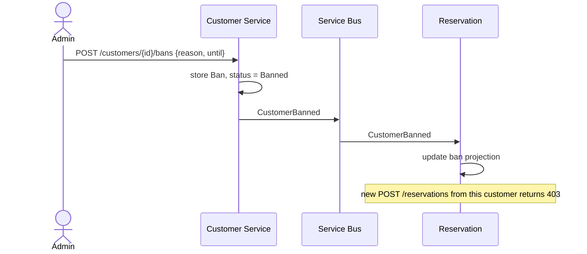

# Customer bans

Admins ban customers who break shop rules: late returns, non-returned sets, neglect of received sets, or non-payment. A lost set bans the customer automatically.

| Item | Value |
|------|-------|
| Actors | Admin, system |
| Services | Customer, Reservation |
| Architecture | [Customer Service](../Architecture.md#36-customer-service) |

## Rules

- A ban has a reason (`LateReturn`, `NonReturn`, `Neglect`, `NonPayment`, `Other`), a comment, who banned, from, until (null = permanent), and lifted at.
- Banned customers cannot create reservations. Reservation keeps a local ban projection built from `CustomerBanned` / `CustomerUnbanned`.
- Existing confirmed reservations of a banned customer are not cancelled automatically. The admin decides case by case.
- **Automatic ban:** `ReservationLost` bans the customer with reason `NonReturn`, `BannedBy = system` (see [Overdue and lost sets](10-overdue-and-lost-sets.md)).
- **Soft block (not a ban):** a customer with an `Overdue` reservation cannot create new reservations.

## Endpoints

| Method | Route | Policy | Purpose |
|--------|-------|--------|---------|
| POST | `/customers/{id}/bans` | `AdminOnly` | Ban customer |
| DELETE | `/customers/{id}/bans/{banId}` | `AdminOnly` | Lift ban |

## Events

| Direction | Events |
|-----------|--------|
| Publishes | `CustomerBanned`, `CustomerUnbanned` |
| Consumes | `ReservationLost` (automatic ban) |

## Flow

