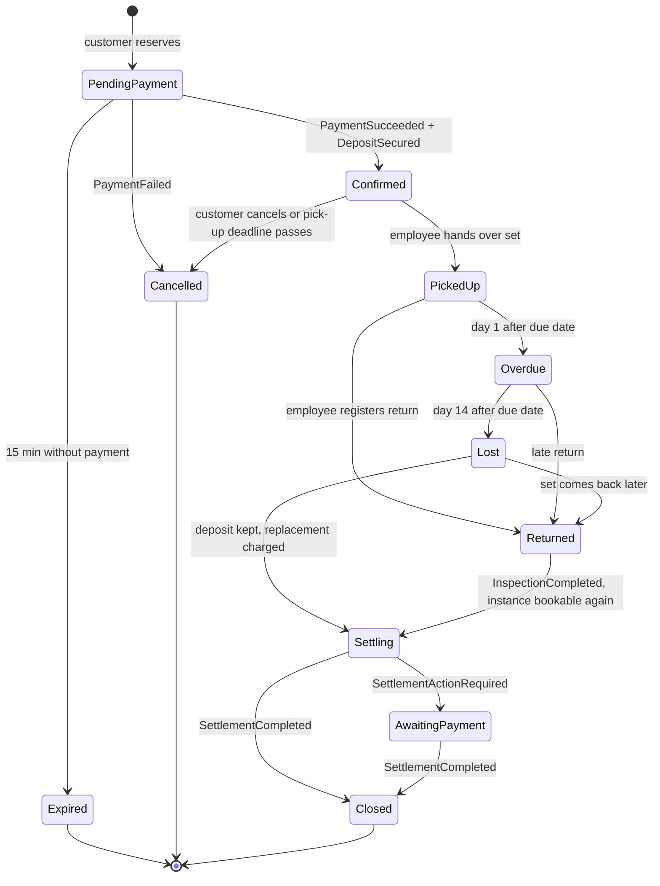
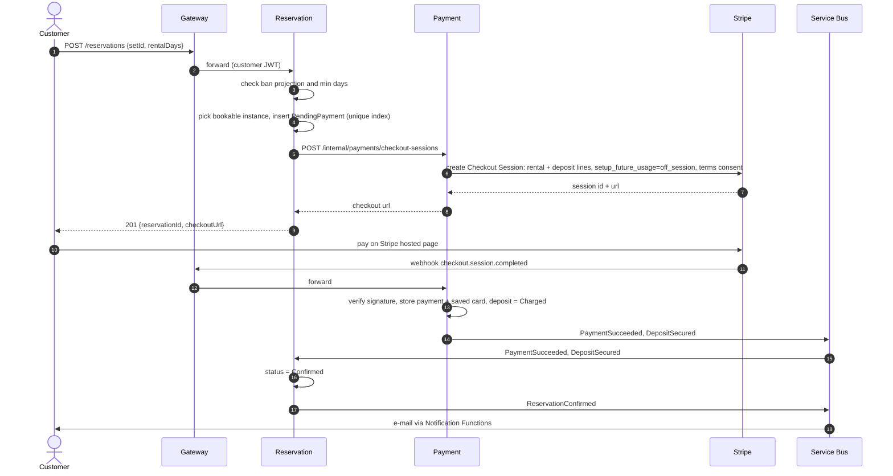

# Reservation and payment

Customers reserve a set that is ready now, choose the number of rental days, and pay rental plus deposit with Stripe. Customers see their reservation history in their portal.

| Item | Value |
|------|-------|
| Actors | Customer, Employee, Admin |
| Services | Reservation, Payment, Stripe |
| Architecture | [Reservation Service](../Architecture.md#33-reservation-service), [Payment Service](../Architecture.md#34-payment-service) |
| Related | [Deposit](07-deposit.md), [Pick-up](08-pickup.md), [Return and inspection](09-return-and-inspection.md), [Overdue and lost sets](10-overdue-and-lost-sets.md) |

## Booking model: book what is ready now

Customers do not book future dates. A customer can reserve a set only when at least one instance is in the shop, inspected, and ready. An instance that is rented, overdue, or waiting for inspection cannot be booked by anybody. It becomes bookable again when the inspection is completed and the set is in a condition fit for the next customer.

## Instance availability

An instance is **bookable** when both are true:

1. Its physical status (from Catalog) is `Available` (not `InMaintenance`, `Retired`, or `Lost`).
2. It has no **active** reservation. Active statuses are `PendingPayment`, `Confirmed`, `PickedUp`, `Overdue`, and `Returned` (back in the shop, inspection not finished).

When `InspectionCompleted` arrives, the reservation moves to `Settling`, which is not active. The instance is bookable again at that moment, unless the inspection result sets it `InMaintenance` in Catalog. Deposit settlement does not block the next customer.

To reserve, the service picks a bookable instance of the set and inserts the reservation. If two customers race for the last instance, the database rejects one insert (partial unique index, see [Architecture](../Architecture.md#33-reservation-service)). The service then tries the next bookable instance or returns `409 Conflict`.

## Rules

- The customer chooses `RentalDays`. It must be at least `minRentalDays` of the set.
- Banned customers cannot create reservations (see [Customer bans](05-customer-bans.md)).
- A customer with an `Overdue` reservation cannot create new reservations (soft block).
- Prices, deposit, replacement value, late fee and minimum days are copied from the catalog at booking time (price snapshot).
- A `PendingPayment` reservation holds the instance for 15 minutes. A background job expires unpaid holds.
- Checkout charges the rental and the deposit (see [Deposit](07-deposit.md)). Checkout shows terms that allow later charges for late fees, damage, and loss.
- The customer can cancel before pick-up. Refund rules apply.
- Customers see their reservation history and payment history (including deposit status).

## Reservation lifecycle

## Endpoints

| Method | Route | Policy | Purpose |
|--------|-------|--------|---------|
| GET | `/reservations/availability?setId` | Anonymous | Number of instances ready to book now |
| POST | `/reservations` | `CustomerOnly` | Create reservation hold, returns Stripe Checkout URL |
| GET | `/reservations/me` | `CustomerOnly` | Reservation history of the signed-in customer |
| GET | `/reservations/me/{id}` | `CustomerOnly` | Reservation details |
| POST | `/reservations/me/{id}/cancel` | `CustomerOnly` | Cancel before pick-up (refund rules apply) |
| GET | `/reservations?status&date&customerId` | `EmployeeOrAdmin` | Staff search (today's pick-ups, overdue, ...) |
| POST | `/internal/payments/checkout-sessions` | Internal (managed identity token) | Create Checkout Session (rental + deposit) for a reservation |
| POST | `/payments/webhooks/stripe` | Stripe signature | Receive Stripe events |
| GET | `/payments/me` | `CustomerOnly` | Customer payment history, deposit status |
| GET | `/payments?reservationId` | `EmployeeOrAdmin` | Payments and settlement of a reservation |

## Events

| Event | Publisher | Consumers |
|-------|-----------|-----------|
| `ReservationCreated` | Reservation | Notification |
| `ReservationConfirmed` | Reservation | Notification, Rental Timer Functions |
| `ReservationExpired` | Reservation | Payment, Notification |
| `ReservationCancelled` | Reservation | Payment, Notification, Rental Timer Functions |
| `PaymentSucceeded`, `PaymentFailed` | Payment | Reservation |
| `DepositSecured` | Payment | Reservation |

## Flow: reserve and pay

