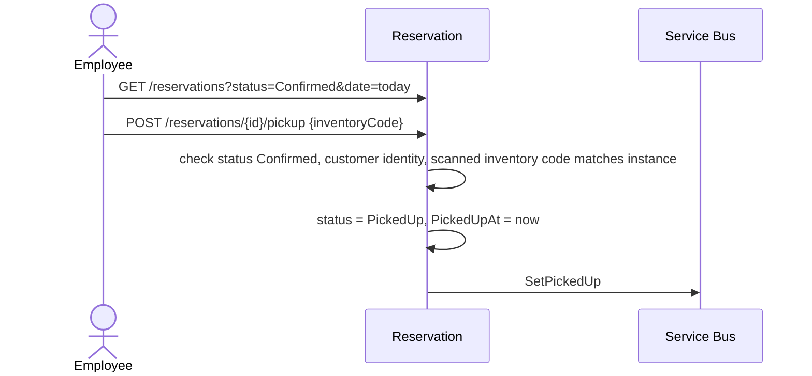

# Pick-up

An employee hands the reserved set to the customer. The rental time starts at pick-up. A reservation that is not picked up in time is cancelled as a no-show.

| Item | Value |
|------|-------|
| Actors | Employee, Admin, system |
| Services | Reservation, Rental Timer Functions |
| Architecture | [Reservation Service](../Architecture.md#33-reservation-service), [Rental Timer Functions](../Architecture.md#373-rental-timer-functions) |

## Rules

- The employee checks that the reservation is `Confirmed` and verifies the customer's identity.
- The employee scans the QR label on the box. The scanned inventory code must match the instance of the reservation. A different box is rejected (`409`), so the customer always gets the instance that was reserved and paid for.
- A set can be picked up only when the deposit status is `Charged` or `Held`.
- Rental time starts at pick-up: `DueDate = PickedUpAt.Date + RentalDays`. Late pick-up does not shorten the rental.
- After payment, the customer must pick up the set before `PickupDeadline` (default: 2 days after confirmation, configurable).
- The `PickupDeadline` orchestration (`pickup-{reservationId}`) starts on `ReservationConfirmed`. At the deadline it calls `timers/no-show`. `SetPickedUp` or `ReservationCancelled` stops it.
- A no-show is `Cancelled`: the rental is not refunded, the deposit is refunded (or the hold canceled). The instance becomes bookable again. This rule is configurable.

## Endpoints

| Method | Route | Policy | Purpose |
|--------|-------|--------|---------|
| GET | `/reservations?status&date&customerId` | `EmployeeOrAdmin` | Staff search (today's pick-ups) |
| POST | `/reservations/{id}/pickup` | `EmployeeOrAdmin` | Hand over set to customer. Body contains the scanned `inventoryCode` |
| POST | `/internal/reservations/{id}/timers/no-show` | Internal (managed identity token) | Called by Rental Timer Functions at the pick-up deadline |

## Events

| Event | Publisher | Consumers |
|-------|-----------|-----------|
| `SetPickedUp` | Reservation | Notification, Rental Timer Functions |
| `ReservationCancelled` | Reservation | Payment, Notification, Rental Timer Functions |

## Flow

