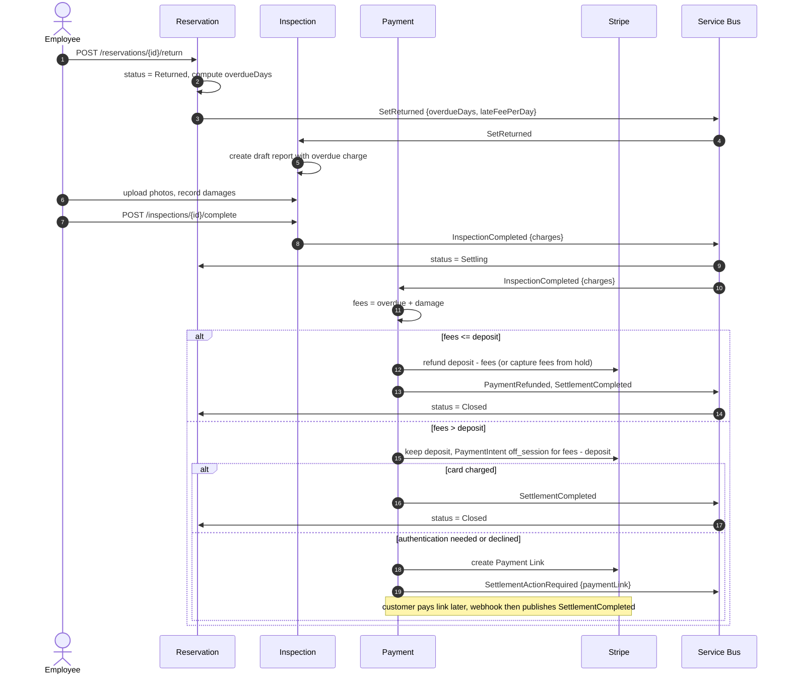

# Return and inspection

The customer brings the set back. An employee registers the return, inspects the set, records missing pieces and damages with photos, and completes the inspection. Charges from the inspection settle the deposit.

| Item | Value |
|------|-------|
| Actors | Employee, Admin, Customer (reads findings) |
| Services | Reservation, Inspection, Payment, Catalog, Media Functions |
| Architecture | [Inspection Service](../Architecture.md#35-inspection-service), [Reservation Service](../Architecture.md#33-reservation-service) |
| Related | [Deposit](07-deposit.md#settlement) |

## Rules

- The employee scans the QR label on the returned box. The scan finds the active reservation of that instance, so the employee does not search by customer.
- Return can be registered for `PickedUp`, `Overdue`, and `Lost` reservations.
- Overdue days are computed at return: `max(0, ReturnedAt.Date - DueDate)`. The late fee is `overdueDays * lateFeePerDay`.
- `SetReturned` creates a draft inspection report with `overdueDays` and the overdue charge already filled in.
- The employee records missing pieces, damages (description, severity, photos), and the resulting condition.
- Photos are uploaded to `inspection-photos/originals/` through a SAS URL. Media Functions store a resized copy without EXIF data (location, device) in `inspection-photos/processed/`.
- Completing the inspection publishes `InspectionCompleted` with the charge lines (overdue, damage):
  - Reservation moves to `Settling`. The instance is bookable again, unless Catalog sets it `InMaintenance`.
  - Catalog updates the instance condition.
  - Payment settles the deposit.
- The customer can see the findings for their own reservation.
- A `Lost` set that comes back is inspected as usual. The admin decides about a partial refund and lifting the ban.

## Inspection report

```json
{
  "id": "insp-...",
  "reservationId": "...",
  "instanceId": "...",
  "kind": "Return",
  "inspectedBy": "employee object id",
  "inspectedAt": "2026-11-25T10:00:00Z",
  "missingPieces": [{ "partNumber": "3001", "quantity": 2 }],
  "damages": [{ "description": "Cracked base plate", "severity": "Major", "photoBlobs": ["..."] }],
  "overdueDays": 2,
  "charges": [
    { "kind": "Overdue", "amount": 1000 },
    { "kind": "Damage", "amount": 2500 }
  ],
  "resultingCondition": "Worn",
  "status": "Completed"
}
```

## Endpoints

| Method | Route | Policy | Purpose |
|--------|-------|--------|---------|
| GET | `/reservations/by-instance/{inventoryCode}/active` | `EmployeeOrAdmin` | Find the active reservation of a scanned box |
| POST | `/reservations/{id}/return` | `EmployeeOrAdmin` | Register return (also for `Overdue` and `Lost`), starts inspection |
| POST | `/inspections` | `EmployeeOrAdmin` | Start inspection for a returned reservation |
| POST | `/inspections/{id}/photos/upload-url` | `EmployeeOrAdmin` | SAS URL for photo upload |
| PUT | `/inspections/{id}` | `EmployeeOrAdmin` | Record missing pieces, damages, condition |
| POST | `/inspections/{id}/complete` | `EmployeeOrAdmin` | Finish inspection, publish charges for settlement |
| GET | `/inspections/{id}` | `EmployeeOrAdmin` | Read report |
| GET | `/inspections/me?reservationId` | `CustomerOnly` | Customer sees findings for own reservation |

## Events

| Event | Publisher | Consumers |
|-------|-----------|-----------|
| `SetReturned` | Reservation | Inspection, Rental Timer Functions |
| `InspectionCompleted` | Inspection | Reservation, Catalog, Payment |
| `ReservationClosed` | Reservation | Customer, Notification |

## Flow: return, inspection and deposit settlement


