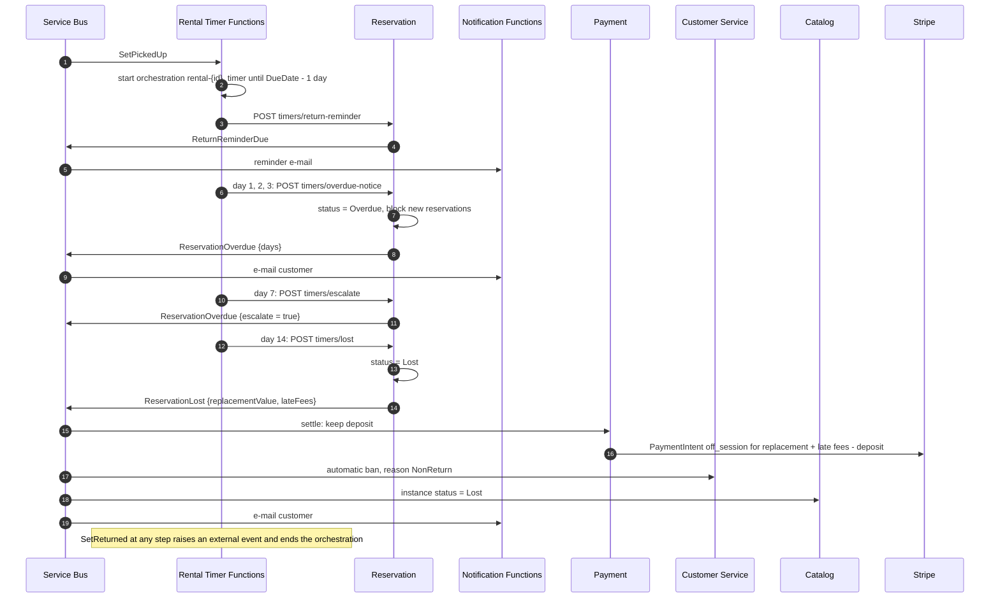

# Overdue and lost sets

If the customer does not bring the set back on the due date, the shop reminds, escalates, and finally treats the set as lost: it keeps the deposit, charges the rest of the replacement value, and bans the customer.

| Item | Value |
|------|-------|
| Actors | System, Employee, Admin |
| Services | Rental Timer Functions, Reservation, Payment, Customer, Catalog, Notification Functions |
| Architecture | [Rental Timer Functions](../Architecture.md#373-rental-timer-functions), [Reservation Service](../Architecture.md#33-reservation-service) |
| Related | [Deposit](07-deposit.md#settlement), [Customer bans](05-customer-bans.md) |

## Rules

One Durable orchestration per rental (`rental-{reservationId}`) starts on `SetPickedUp`. At each step it calls Reservation's internal endpoint. Reservation stays the only writer of reservation data. The rules are configurable:

| Day after due date | Action |
|--------------------|--------|
| -1 | Publish `ReturnReminderDue` (customer gets a reminder e-mail) |
| 1 | Status `Overdue`. Publish `ReservationOverdue` (customer gets e-mail every day until day 3, late fee grows each day) |
| 7 | `ReservationOverdue` with `escalate = true`. The reservation appears on the staff "contact customer" list |
| 14 (`LostAfterDays`) | Status `Lost`. Publish `ReservationLost` with replacement value and accrued late fees |

- `SetReturned` at any step raises an external event and ends the orchestration.
- The internal endpoints are idempotent and status-aware. If the set was returned a second before the timer fired, the call does nothing.
- A customer with an `Overdue` reservation cannot create new reservations (soft block).
- On `ReservationLost`:
  - Payment keeps the deposit and charges `replacement value + late fees - deposit` off-session (see [Deposit](07-deposit.md#settlement)).
  - Customer Service bans the customer automatically (reason `NonReturn`).
  - Catalog sets the instance status `Lost`.
  - The customer gets an e-mail.
- A `Lost` set that comes back later can still be registered with `POST /reservations/{id}/return`. Inspection runs as usual. The admin decides about a partial refund and lifting the ban.

## Endpoints

| Method | Route | Policy | Purpose |
|--------|-------|--------|---------|
| POST | `/internal/reservations/{id}/timers/{step}` | Internal (managed identity token) | Called by Rental Timer Functions. `step` is `no-show`, `return-reminder`, `overdue-notice`, `escalate`, or `lost` |
| GET | `/reservations?status&date&customerId` | `EmployeeOrAdmin` | Staff search (overdue, contact list) |

## Events

| Event | Publisher | Consumers |
|-------|-----------|-----------|
| `ReturnReminderDue` | Reservation | Notification |
| `ReservationOverdue` | Reservation | Notification |
| `ReservationLost` | Reservation | Payment, Customer, Catalog, Notification |

## Orchestration

```text
Rental orchestration
  wait until DueDate - 1 day      -> activity: POST timers/return-reminder
  wait until DueDate + 1 day      -> activity: POST timers/overdue-notice (day 1)
  wait until DueDate + 2/3 days   -> activity: POST timers/overdue-notice (day 2, 3)
  wait until DueDate + 7 days     -> activity: POST timers/escalate
  wait until DueDate + 14 days    -> activity: POST timers/lost
  each wait races against the external event "SetReturned" -> orchestration ends
```

## Flow


